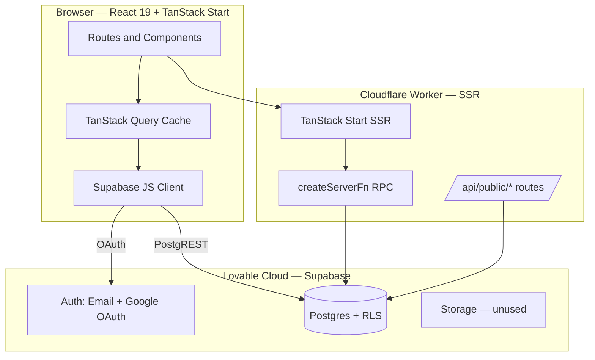
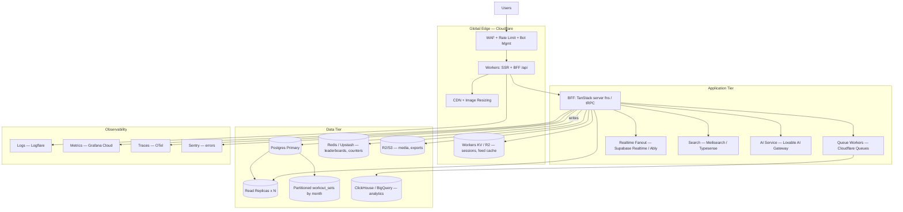

# Gymigo Codebase Audit

## 1. Architecture Diagram

## 2. Tech Stack
- Frontend: React 19, TanStack Router/Start v1, TanStack Query, Vite 7.
- Styling: Tailwind v4 (CSS-first), shadcn/ui, Lucide icons, Recharts.
- Backend: Lovable Cloud (Supabase Postgres + Auth + PostgREST).
- Runtime: Cloudflare Workers (workerd) with nodejs_compat for SSR.
- Types/tooling: TypeScript, Zod, ESLint, Prettier, Bun.

## 3. Modules and Responsibilities
- `src/routes/__root.tsx`: Root shell, head meta, auth listener, error/404 boundaries.
- `src/routes/_authenticated/*`: Gated app surface (dashboard, workouts, routines, programs, progress, feed, coach, etc.).
- `src/routes/auth.tsx` + `onboarding.tsx`: Sign-in/up + first-run profile flow.
- `src/routes/index.tsx`: Public marketing landing.
- `src/components/AppShell.tsx`: Sidebar/mobile nav, sign-out hygiene.
- `src/components/BodyMap.tsx` + `src/lib/muscle-map.ts`: Muscle overlay rendering.
- `src/integrations/supabase/*`: Generated client, auth middleware/attacher, types.
- `src/lib/error-capture.ts` + `src/server.ts` + `src/start.ts`: SSR error normalization + middleware.
- `src/lib/use-units.ts`, `src/lib/lovable-error-reporting.ts`: Cross-cutting hooks/utils.

## 4. Database Schema Summary
- Identity: `profiles` (1:1 auth.users), `user_roles` (enum app_role, separate table).
- Training catalog: `exercises` (seeded + custom), `routines` + `routine_exercises`, `programs` + `program_days` + `program_assignments`.
- Logging: `workouts`, `workout_sets` (set_tag enum, PR flag), `body_measurements`.
- Social: `follows`, `workout_likes`, `workout_comments`, `challenges`, `challenge_participants`.
- Coaching: `coach_clients` (status enum, `is_coach_of` helper).
- All tables RLS-enabled with GRANTs; helpers `has_role`, `is_coach_of`; `handle_new_user` trigger seeds profile + role.

## 5. API Inventory
- No custom REST endpoints; all reads/writes go via Supabase PostgREST from client.
- Auth: `supabase.auth.signInWithPassword`, `signUp`, `signInWithOAuth(google)`, `signOut`, `onAuthStateChange`.
- Data hot paths: `profiles`, `workouts` (+ nested `workout_sets`), `exercises`, `routines`, `programs`, `follows`, `workout_likes`, `workout_comments`, `coach_clients`, `body_measurements`, `challenges`.
- No `createServerFn` handlers or `/api/public/*` routes currently defined.
- No edge functions; no webhooks; no scheduled jobs.

## 6. Authentication Flow
- Email/password + Google OAuth via Supabase; session persisted in `localStorage`.
- New user → `handle_new_user` trigger inserts `profiles` + default `user_roles` row.
- `_authenticated` layout gate redirects unauthenticated to `/auth`; `onboarded=false` redirects to `/onboarding`.
- Root `onAuthStateChange` invalidates router + query cache; sign-out clears cache then `navigate({replace:true})`.
- Server functions unused, so bearer-token middleware in `start.ts` is currently dormant.

## 7. Security Risks
- Client-side trust: all mutations go directly to PostgREST; correctness fully depends on RLS — any missing policy = data leak.
- No rate limiting on auth or writes (Supabase defaults only); brute-force + spam exposure.
- No HIBP/leaked-password check enabled; weak passwords accepted.
- CSV export and profile lookups iterate rows client-side — a hostile client could scrape any `privacy=public` profile at scale.
- `workout_comments` text unsanitized on write; XSS risk if ever rendered as HTML (currently text-only — keep it that way).
- OAuth redirect uses `window.location.origin`; ensure allowed redirect URLs are locked in Supabase to prevent open-redirect on preview domains.
- No audit log for coach-client changes or role escalations.
- Secrets: only publishable key in client (correct); no server-side privileged paths exist yet.

## 8. Scalability Risks
- All aggregations (streak, weekly count, PRs, monthly challenge leaderboard, feed) computed in the browser after row fetch — O(N) per user per view.
- Feed queries all followed users' workouts client-side; unbounded as follow graph grows.
- Progress/history load full `workout_sets` per user with no pagination; large lifters break the page.
- No caching layer (CDN/edge KV) between client and PostgREST; every render hits Postgres.
- No indexes verified beyond PKs/FKs; heavy filters (`user_id, started_at`, `workout_id`, `follower_id`) need composite indexes.
- Realtime not used; likes/comments require manual refetch.
- Single Postgres primary; no read replicas, no partitioning of `workout_sets` (highest-growth table).
- Bodymap images served from `/public` without responsive variants; bandwidth-heavy on mobile.

## 9. Technical Debt
- Fat route components: data fetching, mutations, and UI mixed (e.g. `workout.$id.log.tsx`, `dashboard.tsx`).
- Duplicated Supabase query patterns; no shared `queryOptions` factories or DTO mappers.
- Business logic in components (streak calc, 1RM, PR detection) instead of `src/lib/`.
- Loose typing: `any` in `StatCard`, several `as any` casts around Supabase responses.
- No tests (unit, integration, or e2e); no CI checks beyond typecheck.
- No error/analytics telemetry beyond `reportLovableError` shim.
- Route loaders unused → cannot SSR data; every page waterfalls on client after hydration.
- Onboarding + profile lookup rely on `useEffect` redirects instead of `beforeLoad`.
- No feature flags, no environment separation beyond preview/prod.
- Missing OG images per route; SEO metadata minimal.

## 10. Enterprise-Scale Target Architecture (1M+ users)

- Edge: Cloudflare CDN + WAF + rate limiting; SSR + BFF colocated on Workers; images via CF Image Resizing/R2.
- BFF: All mutations/reads through typed server functions; RLS still on, service-role never touched by client.
- Data: Postgres primary + read replicas; partition `workout_sets` and `workouts` by month; PgBouncer pooling.
- Cache: Redis for hot counters (streaks, likes, leaderboards, feed timelines); Workers KV for session/profile lookups.
- Search: Meilisearch/Typesense for exercise + user discovery instead of `ilike` scans.
- Realtime: Supabase Realtime or Ably for live workout, feed, and coach comments.
- Async: Cloudflare Queues for PR recompute, feed fan-out, notifications, weekly digests.
- Analytics: CDC to ClickHouse/BigQuery for dashboards, cohort/retention, coach insights.
- Observability: Sentry, OTel traces, Logflare, Grafana; SLOs on p95 read/write and auth success.
- Delivery: Preview/staging/prod envs, migrations gated by CI (typecheck, unit, e2e, RLS policy tests, load tests).
- Security: HIBP on, MFA, per-IP + per-user rate limits, audit log table, row-level encryption for PII, signed URLs for media, quarterly pen-test.
- Mobile: Capacitor shell reusing same BFF; push via APNs/FCM through Queues.
