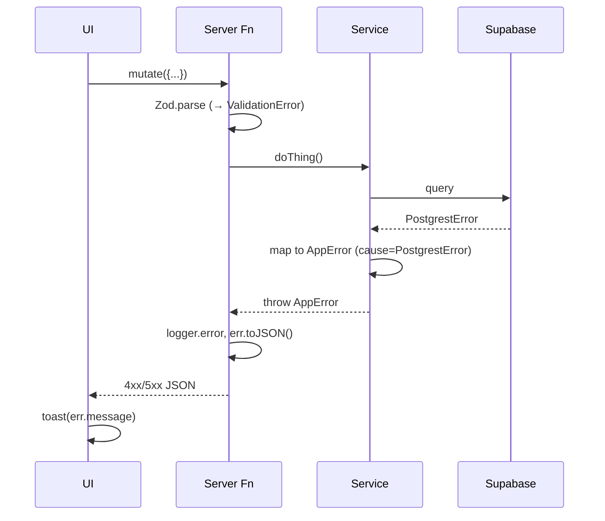

# Error Handling

## Principles

1. **Throw typed errors from services/server fns**, never return `{ error }` objects.
2. **AppError is the single base class**. All other error types extend it.
3. **`expose: true` messages are user-safe**; `expose: false` messages are logged only.
4. **Preserve `cause`** so root-cause chains survive across boundaries.

## Error Classes

Defined in [`src/lib/errors.ts`](../../src/lib/errors.ts):

| Class | Status | Category | Use when |
|-------|--------|----------|----------|
| `ValidationError` | 400 | validation | Zod parse failed, semantic input invalid |
| `UnauthorizedError` | 401 | auth | No signed-in user |
| `ForbiddenError` | 403 | authorization | Signed in but not permitted |
| `NotFoundError` | 404 | not_found | Row missing or hidden by RLS |
| `ConflictError` | 409 | conflict | Uniqueness / state conflict |
| `RateLimitError` | 429 | rate_limit | Rate limiter tripped |
| `ExternalServiceError` | 502 | external | Upstream API failed |
| `AppError` (default) | 500 | internal | Fallback |

## Lifecycle

## Guidelines

- Never `console.error` raw errors from route components — always route through `logger.error`.
- Do not swallow Supabase `PostgrestError` — wrap it in an `AppError` subclass.
- User-facing surfaces (toasts, error boundaries) render `err.publicMessage()`.
- Error boundaries must still call `reportLovableError(error)` for editor telemetry.

## See Also
- [Logging](../observability/logging.md)
- [ADR-0003 Error handling strategy](../adr/0003-error-handling.md)
