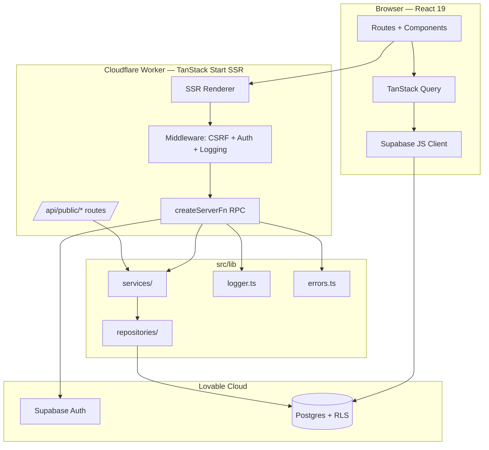

# Architecture Overview

## System Diagram

## Boundaries

| Layer | Responsibility | Rules |
|-------|----------------|-------|
| **Routes** (`src/routes/`) | Data loading, UI composition, navigation | No inline business logic. Use loaders + Query. |
| **Services** (`src/lib/services/`) | Business logic (streak, 1RM, PR detection, permissions) | Pure, framework-free, unit-tested. No direct Supabase imports — depend on repositories. |
| **Repositories** (`src/lib/repositories/`) | Data access — Supabase queries + DTO mapping | One repo per aggregate. Return typed DTOs, not raw rows. |
| **Server Functions** (`*.functions.ts`) | Thin RPC wrappers with `createServerFn` | Validate input with Zod, call services, map errors. |
| **Client Hooks** (`src/hooks/`, `queryOptions`) | Bind services/server fns to Query | Return typed data, no side effects. |

Dependency direction: **routes → hooks → services → repositories → supabase**.
Never the reverse.

## Request Lifecycle (Authenticated Read)

1. Browser navigates → TanStack Router matches route under `_authenticated/`.
2. Managed layout gate (`ssr:false`) checks Supabase session.
3. Loader calls `queryClient.ensureQueryData(queryOptions)`.
4. `queryOptions.queryFn` calls a repository (or server fn for privileged reads).
5. Repository queries Supabase via publishable client; RLS enforces access.
6. DTO is returned to the component, which subscribes via `useSuspenseQuery`.

## Request Lifecycle (Mutation)

1. Component invokes a mutation hook → server fn (or direct Supabase call for RLS-safe writes).
2. Server fn: Zod validates input → rate limit check → service call → repository write.
3. Errors normalized via `toAppError` → JSON-serializable error surface.
4. `logger.info/error` emits structured logs with correlation ID.
5. Client mutation `onSuccess` invalidates affected `queryOptions`.

## See Also
- [Error handling](./error-handling.md)
- [Data loading](./data-loading.md)
- [ADR index](../adr/README.md)
